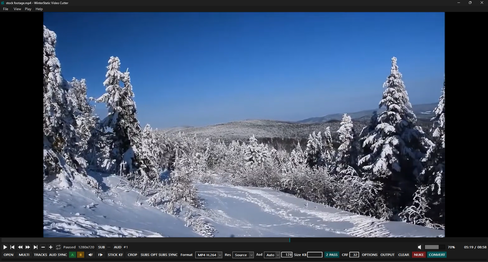

# WinterStatic Video Cutter 0.3.0

WinterStatic Video Cutter is a native Windows video cutter built on libmpv for playback and FFmpeg/ffprobe for editing, remuxing and encoding.

It is designed around direct visual editing: load media, mark a clip, optionally crop or adjust tracks/subtitle timing, then convert without leaving the player.



GitHub: https://github.com/WinterStatic

## Highlights

- Native C++17 / Win32 frontend.
- libmpv playback and frame stepping.
- A/B clip marking directly on the playback timeline.
- Exact adjacent-keyframe navigation with STICK KF.
- Direct crop selection over the displayed video.
- Multi-file ordered joining.
- Embedded and external audio track management.
- Per-track audio timing offsets for supported re-encode jobs.
- Embedded and external subtitle management.
- Constant-offset and two-point subtitle drift correction.
- Format-preserving timing correction for embedded ASS/SSA, SubRip and WebVTT subtitles where practical.
- Target-size and CRF-based video encoding.
- Portable libmpv runtime packaging.

## Requirements

- 64-bit Windows 10 or Windows 11.
- The Full Portable package includes the libmpv playback runtime.
- Editing and conversion require `ffmpeg.exe` and, for probing/indexing features, `ffprobe.exe`.

WinterStatic looks for FFmpeg tools in:

1. `ffmpeg\` beside the application,
2. `ffmpeg\bin\` beside the application,
3. `C:\msys64\mingw64\bin\`,
4. `PATH`.

## Basic workflow

1. Click **OPEN** and choose a media file.
2. Move to the desired start point and click **A**.
3. Move to the desired end point and click **B**. You can also set B first (A defaults to zero); after you explicitly set an endpoint, adjusting the other will not replace it.
4. Adjust Format, Resolution, Audio, Size/CRF, tracks, subtitles or crop as needed.
5. Click **OUTPUT** if you want a manual destination.
6. Click **CONVERT**.

If OUTPUT is not set, the result is written beside the first input using a safe `_cut` or `_joined` filename. Existing names are auto-numbered rather than overwritten unless overwrite is explicitly enabled.

## Cutter controls

- **OPEN**: open one or more media files.
- **MULTI**: manage the ordered input list for multi-file joins.
- **TRACKS**: manage embedded and external audio tracks for single-file jobs.
- **AUD SYNC**: open the per-track audio timing row.
- **A**: set the clip start marker. If B was not explicitly set, B defaults to the video end.
- **B**: set the clip end marker. If A is unset, A defaults to the start.
- **Previous frame / Next frame**: step decoded frames through libmpv.
- **STICK KF**: enable keyframe-oriented seeking. Left/Right adjacent navigation uses an indexed keyframe list when available.
- **CROP**: turn crop editing on or off. While on, draw a crop rectangle and drag its handles or interior to resize/move it. Turning CROP off hides and disables the crop without discarding the saved rectangle.
- **SUBS OPT**: manage included embedded/external subtitle tracks, order, titles and Soft/Burn mode where supported.
- **SUBS SYNC**: configure subtitle timing offsets for supported tracks and workflows.
- **Format**: Source, MKV, MP4, MP4 H.264, WebM, Extract audio, or Audio to M4A.
- **Res**: Source, 1080p, 720p, 480p, or 360p for video re-encode modes.
- **Aud**: Auto, Copy, or None, with an inline bitrate field where applicable.
- **Size KB**: optional target output size for supported video re-encode modes.
- **2 PASS**: use two-pass target-size encoding when supported.
- **CRF**: quality value used when target size is blank.
- **OPTIONS**: overwrite and PowerShell worker options.
- **OUTPUT**: choose an explicit output path.
- **CLEAR**: clear the current Cutter job while preserving persistent preferences.
- **NUKE**: terminate the tracked PowerShell/FFmpeg conversion job tree.
- **CONVERT**: start conversion.

## Keyframe navigation

With STICK KF enabled, Cutter lazily builds an ffprobe keyframe index for the current video when adjacent keyframe navigation is first used.

Paused Left/Right navigation remembers the exact indexed keyframe selected by Cutter so immediate direction reversals do not depend on small `time-pos` reporting differences.

If indexing is unavailable, Cutter reports the problem and falls back to normal five-second seeking.

Seek-bar keyframe behavior remains mpv-driven.

## Audio tracks and sync

TRACKS manages audio inclusion and output order for supported single-file jobs.

AUD SYNC can store a separate timing offset for each included managed audio track.

Embedded audio delay can be previewed in mpv. External-audio preview is not dynamically shifted in the player.

Non-zero audio offsets require audio processing and are therefore rejected by copy-only paths that cannot apply them safely.

## Subtitles

SUBS OPT manages embedded and external subtitle tracks for supported single-file jobs.

External subtitle files may be Soft or Burn where supported. Embedded subtitle tracks are currently Soft only.

SUBS SYNC provides per-track timing offsets for supported subtitle workflows. For external subtitle Burn with A/B clipping, timing synchronization is applied against the original source timeline **before** the subtitle cues are rebased to the clip. External subtitle files are never intentionally overwritten by this process; conversion operates on temporary working copies.

Embedded subtitle Burn is not supported. Bitmap subtitle OCR is not implemented, and the presence of bitmap subtitle modules does not imply all bitmap subtitle workflows are enabled in the UI.

Final subtitle styling still depends on the output container and subtitle codec. For example, MP4 soft subtitles use `mov_text`, so ASS-specific styling cannot be preserved in that final representation.

## Crop

Crop coordinates are derived from the real embedded libmpv video geometry rather than from a separately scaled preview image. For source-resolution H.264 crop output, the filter uses an intermediate YUV 4:4:4 processing step before even-dimension padding and final YUV 4:2:0 encoding; this addresses a tested odd-height bottom-edge flicker.

CROP is a simple on/off editing mode.

Turning it off disables crop application but retains the last rectangle so it can be restored by turning CROP back on.

## Multi-file input

OPEN may select multiple files and MULTI provides ordered Add / Remove / Up / Down / Sort / Clear controls.

Multi-file conversion joins the complete selected files as one timeline.

A/B clipping and managed per-file track selection are currently single-input features.

For stream-copy joins, FFmpeg remains the final compatibility authority.

## Output and worker

Conversions are executed by FFmpeg through a PowerShell worker.

The PowerShell window can be shown or hidden. Visible failed conversions retain their diagnostic console even when close-on-success is enabled; the application can recognize job completion independently of the console lifetime.

A progress strip at the bottom of the Cutter follows FFmpeg progress where duration information is available.

## Known limitations

- Managed TRACKS/SUBS OPT per-file selection is limited to single-input jobs.
- Embedded subtitle Burn is not implemented.
- Bitmap subtitle OCR is not implemented.
- MP4 `mov_text` output does not preserve ASS-specific styling.

## Building from source

Run:

```text
build-native.bat
```

The Windows/MSVC build is authoritative.

The build expects:

- Visual Studio C++ Build Tools / MSVC,
- Windows SDK resource compiler,
- MSYS2 at `C:\msys64`,
- the MINGW64 mpv package.

For a public Full Portable release with matching runtime source collection:

```text
build-native.bat release
```

This release-mode command produces the portable distribution and a separate matching runtime-source archive. The application source ZIP is distributed separately; neither command uploads to GitHub.

## License

The WinterStatic frontend source is released under GPL-3.0-or-later.

Bundled libmpv/runtime components retain their own licenses.

See:

- `LICENSE`
- `ACKNOWLEDGEMENTS.md`
- `THIRD-PARTY-NOTICE.txt` in the source tree, or `libmpv/THIRD-PARTY-NOTICE.txt` in the Full Portable package

before redistributing binaries.
